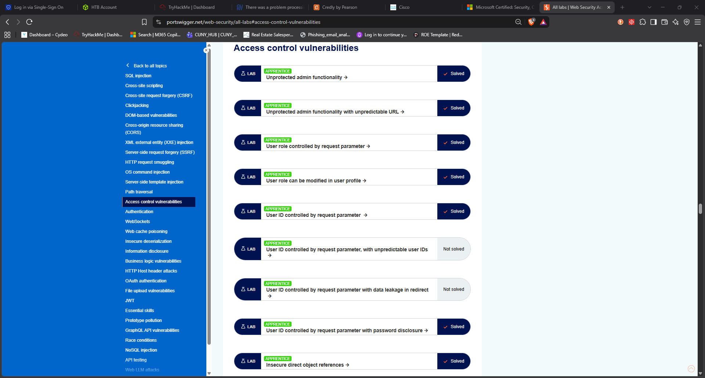

<h1 align="center">🔓 Web Application Access Control — Exploitation & Remediation</h1>

<p align="center">
  <em>Seven broken-access-control vulnerabilities, exploited hands-on with Burp Suite and documented end-to-end — from discovery to fix.</em>
</p>

<p align="center">
  
  
  
  
  
</p>

---

## 📌 Overview

This project documents the exploitation and remediation of **seven access-control (authorization) vulnerabilities** on PortSwigger's Web Security Academy, completed as part of **MAC237 – Computer Security** at LaGuardia Community College (CUNY).

**Access control** is the server-side check of whether an authenticated user is actually *allowed* to perform an action or reach a resource. When it's missing or bypassable, a low-privilege user can seize admin functionality or read another user's private data. It's **#1 on the OWASP Top 10 (A01:2021 – Broken Access Control)** for a reason: it's everywhere, and it's high-impact.

Every exploit here was performed against PortSwigger's own deliberately-vulnerable, account-scoped lab instances — **authorized, legal, educational testing.**

<p align="center">
  
  <br><sub>All seven assigned labs marked <strong>Solved</strong> on the PortSwigger account.</sub>
</p>

---

## 🎯 Skills demonstrated

- **HTTP interception & request tampering** with Burp Suite (Proxy, HTTP history, **Repeater**)
- **Cookie / parameter / JSON manipulation** to escalate privileges
- **Source-code and client-side JavaScript analysis** to find leaked endpoints and secrets
- **IDOR exploitation** — enumerating object references (IDs, filenames) to access others' data
- **Mapping each finding to its root cause and remediation** (defensive mindset)
- Building and troubleshooting a **Kali Linux pentest VM** (networking, DNS, DHCP, tooling)

---

## 🗂️ The seven labs

| # | Lab | Class | Technique | Write-up |
|:-:|-----|-------|-----------|:--------:|
| 1 | Unprotected admin functionality | Vertical | `robots.txt` discloses the admin path | [↳](writeup/access-control-labs.md#task-1--unprotected-admin-functionality) |
| 2 | Unprotected admin (unpredictable URL) | Vertical | Admin URL leaked in client-side JavaScript | [↳](writeup/access-control-labs.md#task-2--unprotected-admin-functionality-with-unpredictable-url) |
| 3 | User role controlled by request parameter | Vertical | Forge `Admin=true` cookie in Repeater | [↳](writeup/access-control-labs.md#task-3--user-role-controlled-by-request-parameter) |
| 4 | User role can be modified in user profile | Vertical | **Mass assignment** — inject `"roleid":2` | [↳](writeup/access-control-labs.md#task-4--user-role-can-be-modified-in-user-profile) |
| 5 | User ID controlled by request parameter | Horizontal | IDOR — swap `id` to steal an API key | [↳](writeup/access-control-labs.md#task-5--user-id-controlled-by-request-parameter) |
| 6 | User ID param + password disclosure | Horizontal | IDOR + password echoed in HTML source | [↳](writeup/access-control-labs.md#task-6--user-id-controlled-by-request-parameter-with-password-disclosure) |
| 7 | Insecure direct object references (IDOR) | Horizontal | Sequential transcript filename (`1.txt`) | [↳](writeup/access-control-labs.md#task-7--insecure-direct-object-references-idor) |

➡️ **[Read the full technical write-up](writeup/access-control-labs.md)** — each lab with vulnerability, exploitation steps, screenshots, and remediation.

---

## 🧰 Toolkit

| Tool | Use |
|------|-----|
| **Burp Suite Community Edition** | Intercepting proxy, HTTP history, **Repeater** for request tampering |
| **PortSwigger Web Security Academy** | Deliberately-vulnerable target labs |
| **Kali Linux (VM)** | Attack platform |
| Browser DevTools / View Source | Inspecting client-side code and leaked secrets |

---

## 🧩 How these attacks break down

```
                 Broken Access Control (OWASP A01:2021)
                 ┌───────────────────────────────────┐
                 │                                   │
     Vertical escalation                   Horizontal escalation / IDOR
  (user → admin privileges)              (user → another user's data)
        Labs 1–4                                  Labs 5–7
```

- **Vertical:** a normal user performs **admin-only** actions (reach an unprotected admin panel, forge an admin cookie, inject an admin role).
- **Horizontal / IDOR:** a user reaches **another user's** resources by changing a direct reference they control (a user `id`, a file number).

---

## 🛡️ Root causes & fixes (the defensive takeaway)

| Root cause seen in these labs | Remediation |
|-------------------------------|-------------|
| No authorization check on privileged routes | **Default-deny**; enforce server-side authz on *every* request |
| Secret URL leaked in JavaScript / robots.txt | Protect the endpoint, not the link — obscurity ≠ security |
| Role carried in a client-controlled cookie | Store roles server-side, bound to the session |
| Server trusts a `roleid` field from the client | **Whitelist** editable fields (mass-assignment protection) |
| Object served by user-supplied `id` | Scope every lookup to the authenticated session |
| Password returned to the client | **Never** send credentials/secrets in a response |
| Predictable file/object references | Use unpredictable IDs **and** authorize every access |

> **Bottom line:** access control must be enforced **server-side, by default-deny, on every single request** — independent of anything the client sends or can see.

---

## 📁 Repository structure

```
.
├── README.md                     ← you are here
├── writeup/
│   └── access-control-labs.md    ← full technical write-up (7 labs + remediation)
├── screenshots/                  ← evidence for every lab
└── docs/                         ← course submission document (.docx)
```

---

## ⚖️ Disclaimer

All testing was performed exclusively against **PortSwigger Web Security Academy** labs — intentionally-vulnerable environments provided for training and scoped to my own account. No real-world systems were targeted. These techniques are shared for **educational and defensive** purposes only.

---

## 👤 Author

**Gokan Bektas** — Cybersecurity student, LaGuardia Community College (CUNY)
Building toward a career in offensive & defensive web security.

<sub>Course: MAC237 – Computer Security · Instructor: Dr. Doyel Pal</sub>
